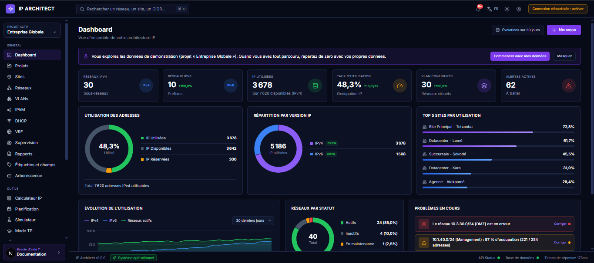
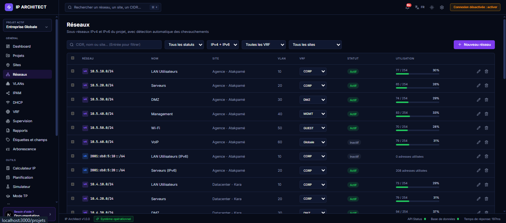

# IP Architect

**Gestion d'adresses IP (IPAM) moderne, en français et en anglais, pour les PME, les fournisseurs d'accès et les enseignants.**
*Modern IPAM for small businesses, ISPs and teachers — French and English, light and dark.*

## Pourquoi IP Architect ?

- **Simple à installer** : un script pour un serveur Debian/Ubuntu, ou Docker. Base SQLite : rien d'autre à installer.
- **Complet pour un réseau d'entreprise** : sous-réseaux IPv4/IPv6 avec détection des chevauchements, adresses, VLAN, VRF, sites, DHCP, étiquettes et champs personnalisés.
- **Il voit votre réseau** : scan des hôtes, supervision et alertes e-mail, topologie automatique (SNMP LLDP/CDP) sur une carte interactive.
- **Pour enseigner** : mode TP avec exercices de sous-réseaux corrigés automatiquement, classes et notes.
- **Prêt pour les équipes** : comptes et rôles (lecteur / éditeur / administrateur), rôles par projet, SSO OpenID Connect, LDAP, jetons d'API, webhooks, journal d'audit avant/après.

## Installation

| Méthode | Commande |
|---|---|
| **Serveur Debian / Ubuntu** | `git clone https://github.com/AdrNazifWadja-networking/ip-architect.git && cd ip-architect && sudo ./deploy/install.sh` |
| **Docker** | `docker compose up -d --build` puis http://localhost:3000 |
| **Développement** | `npm install && npm run dev` (Node.js 22) |

Au premier démarrage, l'application affiche un **code d'installation** à saisir pour créer le premier compte administrateur. Le projet « Entreprise Globale » contient des **données de démonstration** : quand vous avez tout parcouru, le bouton **« Commencer avec mes données »** les supprime et crée votre premier projet.

Guide complet (HTTPS, mises à jour, sauvegardes, Apache) : **[docs/INSTALL.md](docs/INSTALL.md)**.

## Documentation

- [Installation sur serveur](docs/INSTALL.md)
- [Fonctionnalités détaillées](docs/FEATURES.md)
- Documentation intégrée à l'application (menu « Documentation ») et contrat **OpenAPI** sur `/api/openapi`
- [Sécurité](SECURITY.md) · [Contribuer](CONTRIBUTING.md) · [Journal des modifications](CHANGELOG.md)

## Pile technique

Next.js 15 (App Router) · React 19 · TypeScript · Tailwind CSS · SQLite (`better-sqlite3`). Les tests (`npm test`) couvrent le calcul IP, l'IPAM, l'authentification, l'audit, l'import/export, le scan, SNMP/LDAP/SMTP et la documentation.

## Limites connues (v1.0)

- Les secrets enregistrés (clé IA, mot de passe SMTP, secrets SSO/webhooks, communautés SNMP) sont stockés **en clair dans la base** : protégez le fichier de données et ses sauvegardes. Le chiffrement au repos est prévu.
- La découverte SNMP (v2c), le scan réseau et le SSO ont été validés sur des simulations ; les retours sur du matériel réel sont les bienvenus.
- Base SQLite uniquement ; MariaDB/PostgreSQL sont envisagés pour une version ultérieure.

## Licence

IP Architect est publié sous licence **[GNU AGPL v3](LICENSE)** (AGPL-3.0-only) : vous pouvez l'utiliser, l'étudier, le modifier et le redistribuer librement. Si vous modifiez le programme et que vous le proposez à des utilisateurs à travers un réseau (service hébergé), vous devez leur donner accès au code source de votre version, sous la même licence. L'installer pour votre propre organisation, sans le modifier ou sans l'offrir à des tiers, n'impose aucune obligation.

Pour un autre cadre d'utilisation (intégration dans un produit fermé, hébergement commercial), contactez l'auteur via GitHub.

Copyright © 2026 AdrNazifWadja.

---

## English summary

**IP Architect** is a self-hosted IP address management (IPAM) web app: IPv4/IPv6 subnets with overlap detection, addresses, VLANs, VRFs, sites, DHCP scopes, tags and custom fields, network scanning, monitoring with e-mail alerts, automatic SNMP topology (LLDP/CDP), a teaching mode with auto-graded subnetting exercises, accounts and roles, OpenID Connect SSO, LDAP, API tokens, webhooks and a before/after audit log. The interface is available in French and English, in light and dark themes.

**Install**: on Debian/Ubuntu, `sudo ./deploy/install.sh` (Node.js, systemd, Nginx, optional Let's Encrypt); or `docker compose up -d --build`; or `npm install && npm run dev` for development (Node.js 22). SQLite is the only storage, so there is no database server to set up. See [docs/INSTALL.md](docs/INSTALL.md) (in French).

**Demo data**: a first start loads a demo project; the *Start with my own data* button removes it and creates your first project.

**Known limits**: stored secrets are not yet encrypted at rest; SNMP, scanning and SSO have been tested against simulations only. Licensed under the GNU AGPL v3: you may use and modify it freely, but if you offer a modified version to users over a network you must provide them its source code under the same licence. For other terms (closed-source integration, commercial hosting), contact the author on GitHub.
